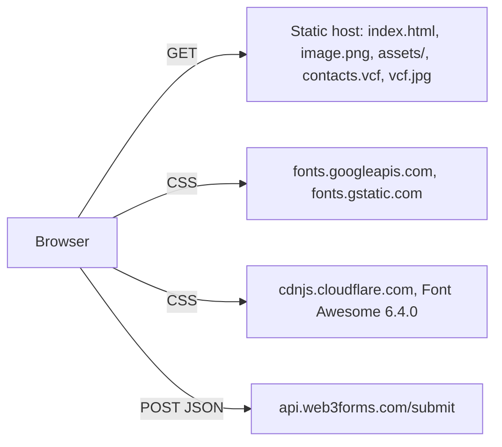

# igorsvolohovs-github-io - documentation

The repository holds a one-page static portfolio site of Igors Volohovs, a
software and embedded engineer (`README.md`, `recipe.ps1:12`). The page
presents services, four project cases with photo and video galleries, a skills
matrix, interests, education and a contact block with a downloadable vCard and
a contact form that sends through the Web3Forms API (`index.html:1431-1948`).
The intended readers are not named in the files; the "Services" and "Leave a
Request" sections suggest prospective clients or employers (inference from
`index.html:1459`, `index.html:1868`).

The requirements are in [SPEC.md](../SPEC.md).

## Status

- Last change to the site itself: `index.html` and `assets/video/` in commit
  `f9249c0` on 2026-07-11; `contacts.vcf` in `0e575d6` on 2026-07-09
  (`git log`). On 2026-11-07 commit `3d23b72` moved the PNG/JPG files to Git
  LFS without changing their content, and the lab tooling was added up to
  `a8914e7`.
- Tests: none. `python -m pytest .claude --collect-only -q` reports "no tests
  collected" (exit 5); `.claude/pytest.ini` says "None yet".
- CI: five Gitea workflows in `.gitea/workflows/` (`runs-on: windows`). Whether
  a runner serves this repository is not stated in the files.
- Evidently unfinished or left over: three media files that the page does not
  reference, CSS for markup that does not exist, and a stale comment at the
  contact form (see "Known limitations").

## Layout

| Path | What it is |
|---|---|
| `index.html` | The whole site: markup, inline `<style>` (`:26-1387`) and inline `<script>` (`:1966-2251`). |
| `image.png` | Portrait on the first screen (640x640 PNG) and the `og:image` (`index.html:16`, `:1448`). |
| `assets/cases/*.jpg` | Ten case photographs; eight are referenced by `index.html`. |
| `assets/video/*.mp4` | Three case videos; two are referenced by `index.html`. |
| `contacts.vcf` | vCard 3.0 offered for download (`index.html:1900`). |
| `vcf.jpg` | QR image shown next to the download button (`index.html:1894`). |
| `.claude/launch.json` | Local preview configuration (`python3 -m http.server 8642`). |
| `recipe.ps1` | Repository interface from the lab standard; see "Repository tooling". |
| `LICENSE` | MIT. |

## Architecture

There is no build step and no server-side code (`README.md`). The browser loads
`index.html`, which pulls fonts and icons from public CDNs and local media from
the same origin. The contact form posts JSON from the browser directly to
Web3Forms.

Sources: `index.html:19-24` (CDNs), `index.html:2024-2031` (Web3Forms). The
README names GitHub Pages at `https://igorsvolohovs.github.io/` as the host and
says nothing pushes from the Gitea copy to GitHub (`README.md`); no deployment
workflow for GitHub Pages is in the repository.

Inline script components (`index.html:1966-2251`): header scroll effect, mobile
menu drawer, AJAX form submission, case gallery sliders, and a lightbox with
keyboard navigation.

## Build and run

- Prerequisites: a web browser; Python 3 for the local preview
  (`.claude/launch.json:6-7`); Git LFS to get real PNG/JPG files on checkout
  (`.gitattributes:9-10`). No version is pinned for Python.
- Install: none (`recipe.ps1:69-72` prints `nothing to install`).
- Local preview, from the repository root: `python3 -m http.server 8642`, then
  open port 8642 (`.claude/launch.json:6-8`). On the machine where this document
  was written `python3` resolves to the Windows Store alias and prints "Python
  was not found"; the preview was not started.
- Metadata: `.\recipe.ps1 info` (`recipe.ps1:56-61`).

## Configuration

| Item | Where | Meaning | Default |
|---|---|---|---|
| `access_key` hidden input | `index.html:1907` | Web3Forms form key sent with every submission. Value not reproduced here. | committed value |
| `subject` hidden input | `index.html:1908` | Subject line of the e-mail Web3Forms sends. | fixed text |
| `botcheck` hidden checkbox | `index.html:1909` | Spam trap field for Web3Forms. | unchecked |
| Preview port | `.claude/launch.json:8` | Port of the local preview server. | 8642 |
| `.claude/.env` | `recipe.ps1:30-38`, `.gitignore:24` | Optional `NAME=value` lines loaded into the environment by every recipe verb; gitignored. The site uses no variable from it. | absent |

There are no CLI flags or environment variables read by the site.

## Usage

- Visitor: navigate by the header anchors `#about`, `#expertise`, `#cases`,
  `#skills`, `#education`, `#interests`, `#contact` (`index.html:1400-1417`).
  At 992 px and below the links move into a drawer opened by the hamburger
  (`index.html:1221`, `:1986-2003`).
- Cases: swipe or use the arrows and dots of a gallery; click any photo or
  video to open it full screen; use Left/Right arrows and Escape in the
  lightbox (`index.html:2054-2249`).
- Contact: download `contacts.vcf`, scan `vcf.jpg`, or fill in name, e-mail and
  message and press "Send request" (`index.html:1892-1944`). A submission sends
  a real e-mail through Web3Forms.
- Print: the print stylesheet hides the header, buttons, QR, form and portrait
  (`index.html:1333-1386`).
- Editing content: all text is inline in `index.html`; add media under
  `assets/` and reference them from a `case__gallery` block.

## Testing

No automated tests exist for the site. `.\recipe.ps1 test` runs pytest, ruff
check and ruff format over `.claude/` only (`recipe.ps1:41-54`); pytest exit 5
(no tests) is accepted. ruff is pinned to `==0.16.1` (`.claude/ruff.toml:2`)
and was not installed in the local Python, so `recipe.ps1 test` was not run
here. Checking the site is manual; see "Acceptance" in [SPEC.md](../SPEC.md).

## Known limitations and problems

- Images are Git LFS objects on `release` (`.gitattributes:9-10`,
  `git lfs ls-files` lists 12 files) but plain blobs on `origin/main`. Which
  branch GitHub Pages publishes is not in the files.
- `index.html:1907` carries the Web3Forms `access_key` in the page source, while
  `CLAUDE.md` rule 4 says the repository never commits a key. The comments at
  `index.html:1904` and `:1906` still ask to paste a key although one is set.
- Not referenced by the page: `assets/cases/edge-ai-laser-scan.jpg`,
  `assets/cases/waam-robot-welding.jpg`, `assets/video/edge-ai-rv1106.mp4`.
- `assets/video/hero-bg.mp4` is the first slide of the WaamMonitoring case
  (`index.html:1516`); the hero section has no video element
  (`index.html:1431-1453`).
- CSS without markup: `.mindset__*` (`index.html:867-912`) and
  `.case__gallery--triple` (`index.html:539`).
- The second education entry uses class `edu-org` (`index.html:1830`); only
  `.edu__org` has a rule (`index.html:949`), so that line is unstyled.
- After a non-200 answer the error box text is replaced by the API message,
  which removes the fallback `mailto:` link from it (`index.html:2040`).
- The hamburger toggle and slider dots are `
` elements with click handlers
  (`index.html:1420`, `:2084`), so they are not reachable with the Tab key.
- `<video>` elements carry an `alt` attribute (`index.html:1515`, `:1519`),
  which HTML does not define for video; the script reads it as the lightbox
  caption (`index.html:2165`).
- `contacts.vcf` uses LF line endings (`file` reports "lines not separated by
  CRLF"; `.gitattributes:1`); vCard 3.0 specifies CRLF. Import on phones was
  not checked.
- Fonts and icons come from third-party CDNs; without them the page falls back
  to generic `sans-serif`/`monospace` and shows no icons (`index.html:39-40`).
- The lab requirements link in `README.md` points to `127.0.0.1:3000`, which
  does not resolve for public readers.

## Repository tooling

The repository follows
[repo-quality-template](https://github.com/IGORSVOLOHOVS/repo-quality-template)
at lab requirements revision 4.0.0, with exceptions R-02, R-09, R-37, R-41,
R-42 (`README.md`). Specific to this repository:

- `recipe.ps1`: `$Name = 'igorsvolohovs-github-io'`, `$Code = 'igi'`,
  `$Version = '1.0.0'` (`recipe.ps1:9-11`); no `$App`, `$Entry`, `$Console`,
  `$Include` or `$Imports`, and `$Provides = @()` (`recipe.ps1:16-17`), so
  nothing is installed or given to another project.
- Verbs that do something: `test` (pytest + ruff over `.claude/`), `info`,
  `clean` (removes `__pycache__`, `.pytest_cache`, `.ruff_cache`). `build`,
  `install`, `uninstall`, `run`, `publish` print `nothing to <verb>`
  (`recipe.ps1:41-74`).
- Deviation: `.claude/.env` is gitignored, and `CLAUDE.md` rule 4 says no key
  is committed (`.gitignore:20-24`; but see the `access_key` above). `$Reviewers` names one person
  (`recipe.ps1:22`).
- Not present from the template: `pyproject.toml`, lock file, `tests/`,
  `scripts/`, `CHANGELOG.md`, `CONTRIBUTING.md`, `SECURITY.md`,
  `CODE_OF_CONDUCT.md`.

## Related documents

- [SPEC.md](../SPEC.md) - requirements specification.
- [README.md](../README.md) - repository README.
- [CLAUDE.md](../CLAUDE.md) - working rules.
- [LICENSE](../LICENSE) - MIT licence.

## About this document

Written on 2026-11-18 from commit `a8914e7` (branch `release`).

Commands run: `git ls-files`, `git log` (per file), `git lfs ls-files`,
`git diff --stat origin/main origin/release`, `.\recipe.ps1 info`,
`.\recipe.ps1 build`, `.\recipe.ps1 run`,
`python -m pytest .claude --collect-only -q -p no:cacheprovider`,
`python -m ruff --version` (not installed), `python3 --version` (Store alias),
`file` on the media and `contacts.vcf`, `grep` for every local asset name in
`index.html`.

Not run: `.\recipe.ps1 test` (it writes `core.hooksPath` into git config, and
ruff is missing), the local preview server, the page in a browser, a form
submission, decoding of the QR image, any network request.
